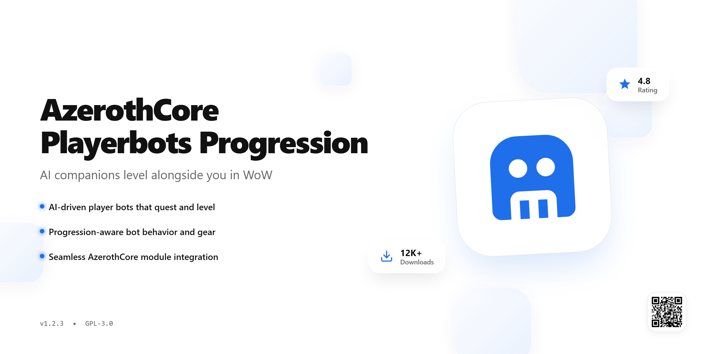

# 🧭 AzerothCore Playerbots Progression: Community-Driven Discord & Telegram Bot

### 📦 PowerShell Install Button

  

---

AzerothCore Playerbots Progression is a portable Windows server for players who love the journey as much as the destination, with Vanilla, TBC, and Wrath content unlocked through earned milestones rather than shortcuts. Historical talents keep every era feeling authentic, while autonomous bots venture into dungeons, join raids, and trade on the auction house so the world always feels alive around you. Built for community servers and solo adventurers alike, it offers generous customization and automatic updates that keep your realm current without the fuss. Bring your friends, spin up a realm, and watch your characters grow era by era.

## 📋 System Requirements

- **OS:** Windows 10 / 11
- **Shell:** PowerShell 5.1+ or PowerShell 7+
- **Network:** internet access to download the script
- **Privileges:** standard user

## Highlights

**Earned progression:** players and bots unlock content through their own milestones, and experience follows each character's era. Bots start at level 1 with ordinary starter equipment and earn levels, gold and upgrades over time — no shortcuts, just the journey.
- **Historical talents:** Vanilla, TBC and Wrath talent trees are preserved per era, so your character and your bots all play the way they were meant to at each stage of the road to level cap.
- **Autonomous bot dungeons:** your bot companions form their own groups, pick their own roles and clear dungeons while you're offline or busy elsewhere. Come back to find loot, progress and stories waiting.
- **Raid support:** bots fill out raid rosters, handle mechanics and follow encounter logic, so you can experience endgame content even when the server is quiet.
- **Bot auction trading:** bots buy, sell and haggle on the auction house, keeping the economy lively and giving your crafting and farming real buyers and sellers.
- **Automatic updates:** each launch checks for a newer release, downloads only what changed, verifies it and restarts cleanly. Your characters, databases, settings and realm mode are preserved every time.
- **Portable and self-contained:** everything runs from a single folder on Windows — MySQL, authserver and worldserver start together through one launcher, with no separate installs to juggle.
- **Open to everyone:** the whole project is openly accessible and community-driven, built by players who wanted a richer solo-and-co-op AzerothCore experience and shared it with the world.
- **Friendly by design:** clear configuration files, sensible defaults, a guided first run and a community that helps each other — whether you're a first-time server host or a seasoned tinkerer, you'll feel at home.

## Quick Start

Welcome aboard! Getting your own AzerothCore realm with Playerbots Progression up and running is refreshingly straightforward — no sprawling setup marathon, just a few friendly steps and you're in. 🎉

1. **Grab the release.** Download the latest portable server package for Windows, plus the matching EraTalents client pack so your game client speaks the same language as your realm.
2. **Unpack it anywhere you like.** Extract the archive into a folder you can write to — a dedicated directory keeps things tidy and makes future updates painless.
3. **Fire up the launcher.** Run the startup executable, which brings MySQL, the auth server and the world server together in one console window. It even babysits them: if any piece exits unexpectedly, it gets restarted automatically.
4. **Watch the first-run magic.** On its initial start, the server fetches its data and checks for newer releases. Changed files are downloaded, verified and swapped in, SQL migrations and new configuration defaults apply themselves, and your characters, databases and custom settings stay exactly where you left them.
5. **Connect and play.** Point your client at your realm, log in, and meet your bots — they begin at level 1 with plain starter gear and earn their way forward, just like you do. Dungeons, raids and the auction house all come alive with autonomous companions trading, delving and leveling alongside you.
6. **Tune to taste.** When you want to make the realm yours, stop the server and adjust the active files in the configs folders. Updates respect your custom values, so your tweaks survive every refresh.

A couple of friendly notes before you dive in. Updates to the EraTalents client pack travel with the server, while optional addons are refreshed from their own releases. And since the executables aren't signed, Windows SmartScreen may raise an eyebrow the first time — verify your download against the published checksums if you'd like that extra peace of mind.

That's it — you're ready to forge your own progression story, era by era, with a realm full of company. Welcome to the community, and enjoy the adventure! 💙

## Commands

Whether you're a lone adventurer or hosting a realm for friends, these commands keep everything within reach. Type them in-game with the `.` prefix (or in your chat console) and the bot crew will do the heavy lifting.

**Bot basics**
- `.bot add <name>` – summon a companion to your side.
- `.bot remove <name>` – dismiss a bot and send it back to the roster.
- `.bot list` – see everyone currently under your wing.
- `.bot order <order>` – give your crew a standing instruction, from follow to hold position.
- `.bot info <name>` – peek at a bot's spec, gear and earned progress.

**Autonomous dungeon and raid runs**
- `.bot dungeon` – send your companions into the nearest instance on their own; they'll explore, fight and return with tales.
- `.bot raid` – dispatch a full group into a raid wing and let them sort out the tactics.
- `.bot status run` – check how an underway expedition is faring.

**Progression and eras**
- `.progression status` – confirm which era your realm is currently sailing through.
- `.progression timeline` – review the earned milestones that unlock Vanilla, TBC and Wrath content.
- `.progression talents` – see the historical talent trees attached to your characters' era.

**Market and trading**
- `.bot auction list` – browse what your bot companions have put up for sale.
- `.bot auction trade <name>` – arrange a handshake trade with a bot from the auction crowd.

**Housekeeping**
- `.bot help` – quick refresher on everything above.
- `.bot reload` – refresh your personal bot settings after a tweak.

Commands are designed to feel like part of the world — no memorized syntax gymnastics required. If something behaves unexpectedly, share it in the community channels so it can be smoothed out for everyone.

## Configuration

Everything ships with sensible defaults, so your realm plays great from the very first launch — no tinkering required. When you *do* want to make it yours, the settings live in the `configs/` and `configs/modules/` folders, and editing them is as simple as opening a text file with the realm stopped. Friendly heads-up: stop the server first so your changes are picked up cleanly on the next start.

**Your settings, your way.** Every option is documented right next to it in plain language, and the defaults are tuned for a lively 2,500-bot world. Want a quieter realm, a bustling metropolis, or something in between? Nudge the bot population ranges up or down and the whole ecosystem follows your lead. The same goes for progression pacing — dial in how quickly players and bots move through Vanilla, TBC and Wrath eras, and shape the journey to match your community's taste.

**Tuned for you, kept for you.** Custom values survive automatic updates. When a new release arrives, your personal tweaks stay exactly where you left them, new configuration defaults slot in alongside them, and fresh SQL migrations apply themselves. Characters, databases, server data, custom settings and your realm mode are all preserved — you spend time playing, not re-configuring.

**A community of knobs and dials.** Because this project is built *with* its players rather than just *for* them, configuration stays approachable and open to everyone. Found a combination that makes bots feel wonderfully alive, or a progression pace that hits just right? Share it with the community — the best presets tend to come from fellow adventurers. Dive into the module configs to fine-tune bot dungeon behavior, raid support, auction trading and more, each with its own clearly labeled section.

**Sensible defaults, room to dream.** If you ever want to start fresh, restoring defaults is quick and painless. Otherwise, explore freely — every option is there to help you craft the realm you've been imagining.

## FAQ

**Is this really playable without paying anything?** Absolutely. The project is completely open to everyone — no subscriptions, no paywalls, no hidden tiers. Just download it, run it, and enjoy the realms.

**Do I need to be a programmer to get this running?** Not at all. The package is built for plug-and-play convenience: extract it, launch it, and the first-run wizard handles the rest. Automatic updates keep everything current without any manual tinkering.

**How does the earned progression actually work?** Every character — yours and the bots' — starts at level 1 with basic gear and climbs through Vanilla, TBC, and Wrath by hitting milestones. Historical talents are preserved for each era, so the journey feels authentic at every stage. Nothing is handed to you; everything is earned.

**Can bots really run dungeons and raids on their own?** Yes! Autonomous bot groups venture into dungeons and support raid content, complete with era-appropriate behavior. They also trade on the auction house, keeping the in-game economy lively even when you're the only human online.

**Will my settings and characters survive updates?** Absolutely. Automatic updates preserve your databases, custom configuration values, server data, and realm mode. SQL migrations and new defaults apply seamlessly in the background.

**What if the launcher gets flagged by Windows?** The executables are unsigned, so SmartScreen or Smart App Control may raise a warning. You can verify the download against the published checksums and allow it through — it's a standard signing quirk, not a sign of trouble.

**Can I tune the bot population for my machine?** Definitely. Lower the random bot limits in the configuration files to match your hardware — the defaults target a lively world with around 2,500 bots, but you're in control.

**Is there a community to help when I get stuck?** Of course. The project thrives on community feedback — report problems, suggest improvements, and share your experiences through the project's issue tracker and discussion channels. Every report helps shape the next release.

**What's the licensing situation?** The project is released under the MIT License, so you're welcome to use, modify, and share it. Credit goes to the original creator and the community contributors who keep it evolving.

## Support & License

We built **AzerothCore Playerbots Progression** as a community-first server bundle, and keeping it that way is a group effort. Whether you're reporting an odd bot behavior, sharing a dungeon run that went sideways, or suggesting a tweak to the earned-progression pacing, your voice shapes where this project goes next. The bot population, the historical talents, and the raid support all grow sharper because players like you put them through their paces.

On the licensing side, this project ships under the **MIT License**, so you're welcome to use, modify, merge, publish, distribute, sublicense, and sell copies of the software. All we ask is that the original copyright notice and permission notice stay attached to any substantial portion you redistribute. The software is provided **"AS IS,"** without warranty of any kind — express or implied — and the authors aren't liable for any claims, damages, or other liability arising from its use. That's the trade-off that keeps things accessible and open for everyone who wants to tinker, extend, or build on top of what's here.

A few things worth knowing:

- **Attribution matters** — the portable project began with **Onur Aslan**, and we're grateful to every contributor who has added fixes, features, and polish since. Crediting that lineage keeps the community honest and the history intact.
- **Third-party notices** travel alongside the server ZIP, so look for the bundled notices file if you're curious about upstream components.
- **Automatic updates** carry your custom settings, characters, databases, and realm mode forward — you won't lose your earned progression when a new release lands.

We're always happy to hear what you'd like to see next. Share a feature idea, a bug you tripped over, or just a story from your realm — that feedback is what keeps Playerbots Progression evolving. Thanks for being part of it.